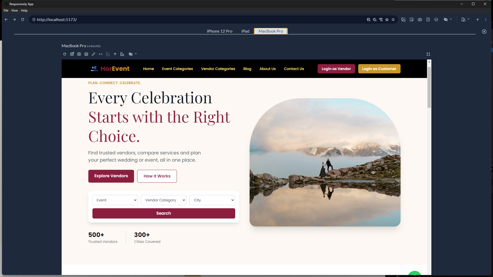
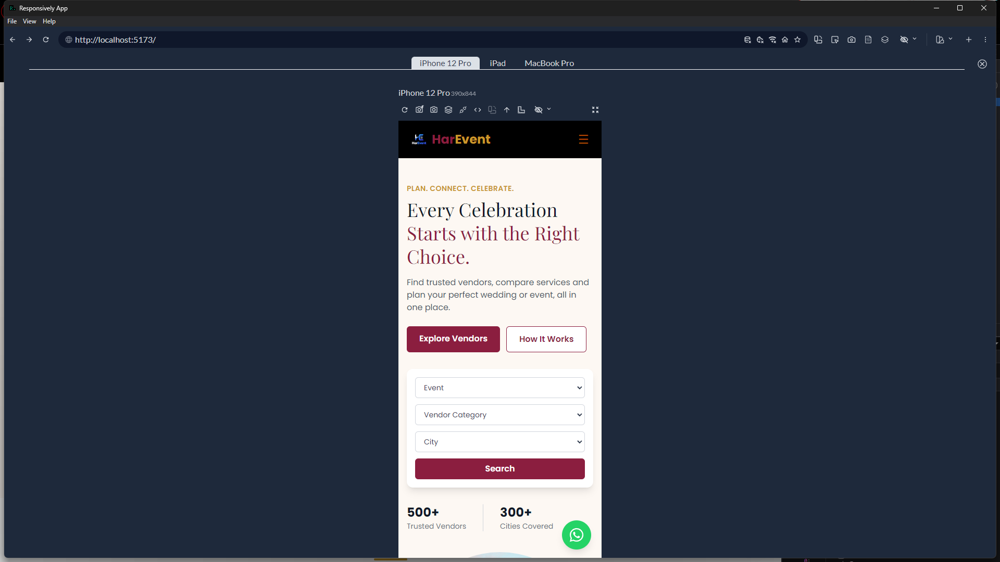
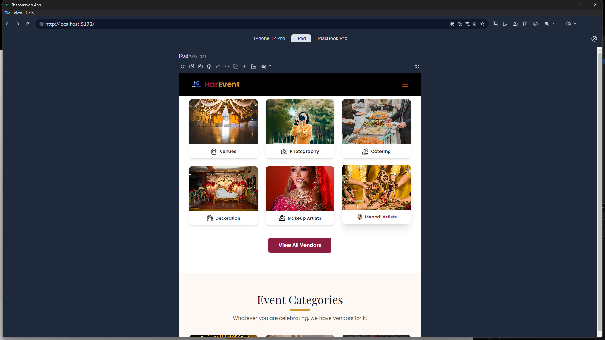

# HarEvent: Event & Vendor Listing Homepage

A responsive, frontend-only homepage for **HarEvent**, an event-planning platform where users can find, compare and contact trusted vendors for weddings and other celebrations. Built as the HarEvent LLP Frontend Developer Intern technical task.

- **Live demo:https://harevent09.netlify.app/
- **Repository:https://github.com/AbserYousuf/HarEvent

## Screenshots

| Desktop | Mobile |
| --- | --- |
|  |  | 

## Features

- **Responsive navbar** with logo, six section links, "Login as Vendor" / "Login as Customer" buttons, and a hamburger menu on mobile
- **Hero banner** with headline, CTA buttons (Explore Vendors, How It Works) and Event / Vendor Category / City search filters
- **Vendor Categories**: Venues, Photography, Catering, Decoration, Makeup Artists, Mehndi Artists (clickable cards plus "View All Vendors")
- **Event Categories**: Weddings, Engagements, Birthday Parties, Corporate Events, Baby Showers, Other Events (clickable cards plus "View All Events")
- **Working filters**: search or card clicks filter sample vendor data and scroll to the results, with active filter chips, a "Clear filters" action and an empty state
- **How HarEvent Works**: four steps (Search, Compare, Connect, Celebrate)
- **Why Choose HarEvent**: Trusted Vendors, Best Prices, Easy & Quick Booking, All in One Place, Customer Support
- **About** and **Blog** sections with expandable "Read more" cards
- **CTA and footer** with quick, customer and vendor links plus contact info
- **Demo login modal** for vendor and customer (no real authentication; closes with Escape or a backdrop click)
- **Floating WhatsApp button** using a click-to-chat link, and a "Contact" button on each vendor card that opens WhatsApp with a prefilled message

## Technologies Used

- [React 19](https://react.dev/)
- [Vite 8](https://vite.dev/)
- [Tailwind CSS 4](https://tailwindcss.com/) (via `@tailwindcss/vite`)
- [React Icons](https://react-icons.github.io/react-icons/)
- Google Fonts: **Playfair Display** (headings) and **Poppins** (body)
- ESLint

## Getting Started

### Prerequisites

- Node.js 20.19 or newer
- npm

### Setup

```bash
# 1. Clone the repository
git clone <your-repo-url>
cd HarEvent

# 2. Install dependencies
npm install

# 3. Start the dev server
npm run dev
```

Open the local URL shown in the terminal (usually `http://localhost:5173`).

### Other scripts

```bash
npm run build     # production build into /dist
npm run preview   # preview the production build locally
npm run lint      # run ESLint
```

## Project Structure

```
HarEvent/
├── public/
│   ├── images/
│   │   ├── events/          # event category images
│   │   ├── icons/           # How It Works / Why Choose icons
│   │   ├── vendors/         # vendor category images
│   │   │   └── vendorIcons/
│   │   ├── Wedding.jpg      # hero image
│   │   └── mandap.jpg
│   ├── HarEvent.png         # logo
│   └── favicon.svg
├── Components/              # Navbar, Hero, VendorC, EventC, VendorResult, ...
├── src/
│   ├── App.jsx
│   ├── constant.js          # WhatsApp number
│   ├── vendor.js            # sample vendor data
│   ├── index.css
│   └── main.jsx
└── index.html
```

## Sample Data

All vendors live in `src/vendor.js` as a plain array. Each vendor has an `id`, `name`, `category`, `city`, `events`, `rating`, `price` and `image`. To add a vendor, add an object using the exact category, city and event names used by the filters.

## Configuration

To change the WhatsApp contact number, edit `src/constant.js`. Use digits only with the country code and no `+` or spaces:

```js
export const WHATSAPP_NUMBER = "917889645618";
```

## Notes

- This is a **frontend-only** project. There is no backend, API, database, payment gateway or real authentication. The login modal is a placeholder.
- Image file names are case-sensitive on Linux hosts (Vercel, Netlify, GitHub Pages), so the paths in the code match the file names in `public/` exactly.
- The layout is fully responsive across desktop, tablet and mobile.

## Credits

Built by _your name_ for the HarEvent LLP Frontend Developer Intern task. HarEvent branding is original and not derived from the reference design.
